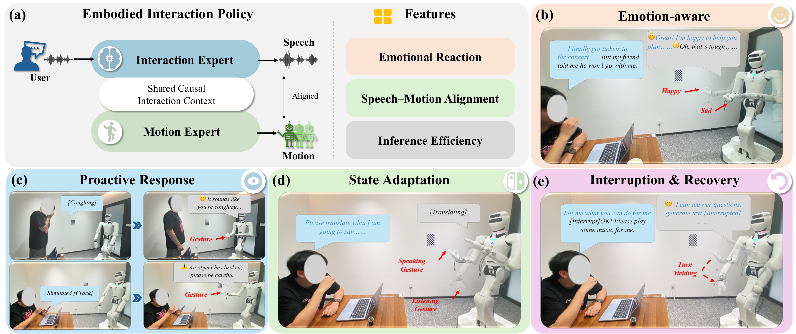

<p align="center">
  <picture>
    <source media="(prefers-color-scheme: dark)" srcset="docs/assets/eip-logo-dark.svg">
    
  </picture>
</p>

<h1 align="center">
  Embodied Interaction Policy:<br>
  A Unified Model for Full-Duplex Human–Robot Interaction
</h1>

<p align="center">
  <a href="https://openreview.net/profile?id=~Youqiang_Gui1">Youqiang Gui</a><sup>1,2</sup>,
  <a href="https://openreview.net/profile?id=~Yunfei_Liu1">Yunfei Liu</a><sup>2,†,‡</sup>,
  Lijian Lin<sup>2</sup>,
  Ye Zhu<sup>2</sup>,
  Jianan Wang<sup>3</sup>,
  Cheng Peng<sup>1,‡</sup>,
  <a href="https://openreview.net/profile?id=~Yu_Li4">Yu Li</a><sup>2</sup>
</p>

<p align="center">
  <em>
    <sup>1</sup> Sichuan University &nbsp;&nbsp;
    <sup>2</sup> International Digital Economy Academy (IDEA) &nbsp;&nbsp;
    <sup>3</sup> Astribot
  </em>
  <br>
  <sub>† Project leader &nbsp;&nbsp; ‡ Corresponding authors</sub>
</p>

<p align="center">
  
  &nbsp;
  <a href="https://youqiang-gui.github.io/EIP/">
    
  </a>
</p>

<p align="center">
  <a href="docs/assets/figures/teaser.pdf">
    
  </a>
</p>

**TL;DR:** EIP couples an audio interaction model with a motion generation model
to coordinate speech and robot motion in real time. The unified framework
generates continuous movements aligned with conversational states and emotions
during full-duplex interactions, including proactive responses and user interruptions.

## Release status

| Resource | Availability |
| --- | --- |
| Training and offline inference code | Included in this repository |
| Project page source and demo videos | Included in `docs/` |
| AIM base weights | Download separately from the upstream model repository |

Full-model training and inference require external weights and data.

## Repository layout

```text
EIP/
├── README.md
├── LICENSE
├── requirements.txt
├── run_stage1.sh
├── run_stage2.sh
├── run_teacher_forcing.sh
├── run_wav_inference.sh
├── src/audiointeraction/    # Interaction backbone and HRI motion modules
├── scripts/hri_mot/         # Training and inference
└── docs/                   # Static project page, published by GitHub Pages
```

## What is included

- Stage I: state-adaptive motion learning across speaking, listening, and idle states.
- Stage II: emotion-aware motion learning with vocal-token and FiLM conditioning.
- Teacher-forced evaluation and standalone WAV inference.

## Environment

The reference environment is Python 3.12 and PyTorch 2.5.1+cu121. Use a CUDA-capable
PyTorch installation for full-model training and inference. Select the build
appropriate for your machine using the [PyTorch installation instructions](https://pytorch.org/get-started/locally/).

```bash
git clone https://github.com/Youqiang-Gui/EIP.git
cd EIP
python3.12 -m venv .venv
source .venv/bin/activate
python -m pip install -r requirements.txt
```

Install FFmpeg and make sure `ffmpeg` is on your `PATH` for audio loading.
Run the commands below from the repository root with this environment active.

## Model weights

### AIM base model

Download AIM separately from the upstream
[AudioInteraction model repository](https://huggingface.co/zhifeixie/AudioInteraction).
Its [source repository](https://github.com/xzf-thu/Audio-Interaction) contains
the upstream model documentation. AIM weights are not redistributed here.

After installing the requirements, download the base model with:

```bash
python - <<'PY'
from huggingface_hub import snapshot_download

snapshot_download(
    repo_id="zhifeixie/AudioInteraction",
    local_dir="checkpoints/aim",
)
PY
export BASE_MODEL_DIR="$PWD/checkpoints/aim"
```

Keep the upstream directory layout. The current loader expects:

```text
checkpoints/aim/
├── model_config.yaml
├── tokenizer.json
├── tokenizer_config.json
├── model.safetensors.index.json
├── model-*.safetensors
├── audiointeraction_ChunkwisedEncoder.pth
└── qwen25OmniConfig/
```

## Expected data inputs

- `ARCH_CHECKPOINT`: the architecture-reference checkpoint for Stage I.
- `POSTTRAIN_INDEX`: expanded interaction JSONL used for listening supervision.
- `COSPEECH_INDEX`: unmodified co-speech JSONL used by Stage I and to validate
  Stage-II row identity.
- `EMOTION_INDEX`: the row-aligned co-speech JSONL with `target_emotion`.
- `IDLE_MOTION_PKL`: the 35-DoF idle-motion sequence used to construct causal
  listening and idle segments.
- `STAGE1_CHECKPOINT`: the Stage-I checkpoint used to initialize Stage II. The
  paper configuration uses `step-015000.pt`.

Every emotion-index record must preserve its corresponding base-index row and
add a `target_emotion` object with a label in:
`happy`, `sad`, `angry`, `surprise`, `normal`, or `urgent`.

## Stage I: State-adaptive motion learning

Stage I trains the motion expert on EI-Data to generate continuous robot motion
across speaking, listening, and idle states. With the interaction expert frozen,
the model learns state-adaptive behavior through flow matching, conditioned on
interaction context, robot state, and the speaking-state component of the vocal
token.

```bash
export BASE_MODEL_DIR=/path/to/base_checkpoint
export ARCH_CHECKPOINT=/path/to/architecture_reference.pt
export POSTTRAIN_INDEX=/path/to/expanded_interaction.jsonl
export COSPEECH_INDEX=/path/to/cospeech.jsonl
export IDLE_MOTION_PKL=/path/to/idle_motion.pkl
export OUTPUT_DIR=/path/to/output/stage1
export NPROC_PER_NODE=8
bash run_stage1.sh
```

## Stage II: Emotion-aware motion learning

Stage II builds on the Stage-I checkpoint to learn emotion-aware motion.
Semantic emotion labels condition the motion expert through the vocal token
and FiLM modulation. Training uses co-speech examples sampled uniformly across
six emotion categories, aligning speaking gestures with the emotion of the
response.

```bash
export BASE_MODEL_DIR=/path/to/base_checkpoint
export STAGE1_CHECKPOINT=/path/to/stage1/step-015000.pt
export COSPEECH_INDEX=/path/to/cospeech.jsonl
export EMOTION_INDEX=/path/to/cospeech_with_emotion.jsonl
export IDLE_MOTION_PKL=/path/to/idle_motion.pkl
export OUTPUT_DIR=/path/to/output/stage2
export NPROC_PER_NODE=8
bash run_stage2.sh
```

## Offline inference

Teacher-forced evaluation:

```bash
export BASE_MODEL_DIR=/path/to/base_checkpoint
export CHECKPOINT=/path/to/stage2/final.pt
export COSPEECH_INDEX=/path/to/cospeech_with_emotion.jsonl
bash run_teacher_forcing.sh
```

Standalone WAV inference (estimated TTS timing and no robot renderer by
default):

```bash
export BASE_MODEL_DIR=/path/to/base_checkpoint
export CHECKPOINT=/path/to/stage2/final.pt
export WAV_PATH=/path/to/input.wav
bash run_wav_inference.sh
```

For Stage-I teacher-forced evaluation, also set `EXPANDED_INDEX` to the
expanded interaction index. Stage-II evaluation uses the annotated co-speech
index and does not require expanded listening episodes.

For WAV inference, set `EMOTION_OVERRIDE` to one of the six emotion labels for
a controlled comparison; the default `auto` follows the generated semantic
emotion tag. Overrides affect speaking motion only, and silence always uses
`none`.

## Citation

The BibTeX entry will be added when the paper is available.

## Acknowledgements

This work builds on [AudioInteraction / AIM](https://github.com/xzf-thu/Audio-Interaction),
[LitGPT](https://github.com/Lightning-AI/litgpt), and
[Qwen2.5-Omni](https://github.com/QwenLM/Qwen2.5-Omni).
See [THIRD_PARTY_NOTICES.md](THIRD_PARTY_NOTICES.md) for retained source notices.

## License

EIP source code is released under the [Apache License 2.0](LICENSE).
Third-party components retain their original copyright and license notices.
Separately downloaded models and datasets are governed by their respective
licenses; refer to the upstream model cards and dataset documentation.
